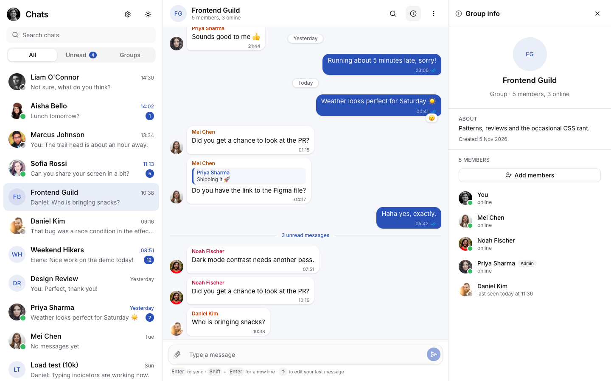
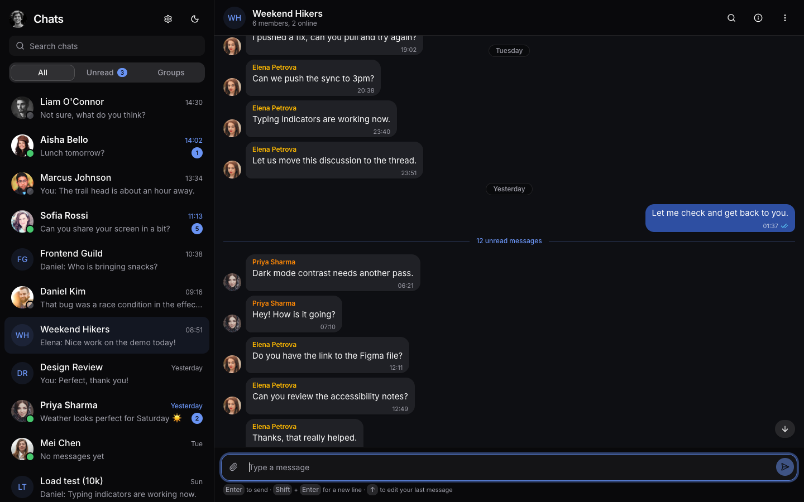
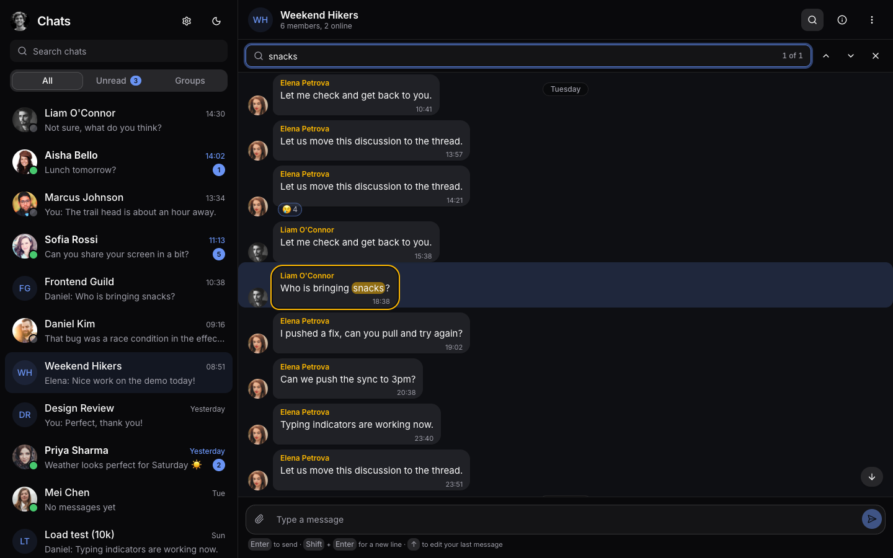
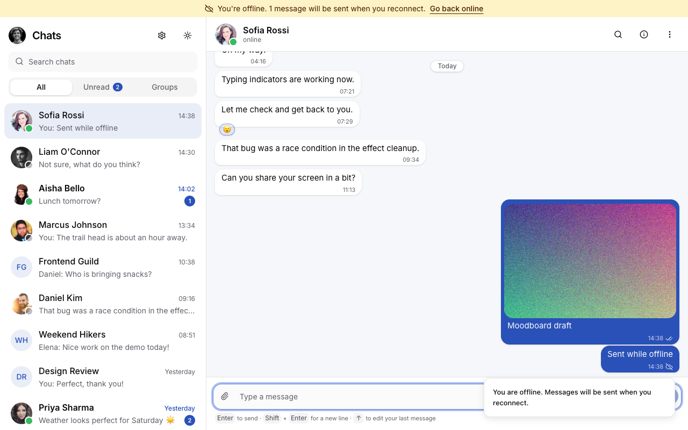
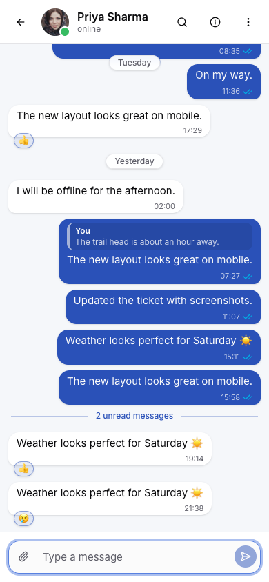
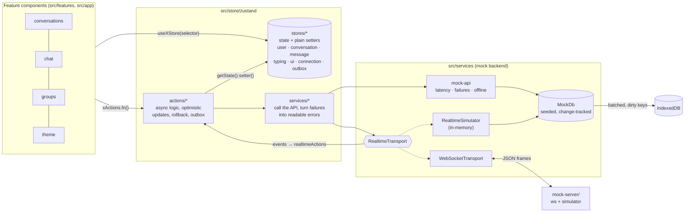

# Quantum Chat

A responsive chat app in the style of a simplified Slack or WhatsApp Web, built for the Quantum Heaps Senior Frontend Developer take-home. It covers every functional requirement in the brief (sections A–E) and all eight optional challenges, against a mock backend that runs entirely in the browser.

**Stack:** React 19 · TypeScript (strict) · Vite 6 · Tailwind CSS 4 · shadcn/ui (Radix) · Zustand 5 + immer · React Hook Form + zod · Lucide · TanStack Virtual · Vitest + Testing Library



| Dark theme | In-chat search | Offline queue and attachments | Mobile |
|---|---|---|---|
|  |  |  |  |

---

## Quick start

Requires Node 20 or later (developed on Node 22).

```bash
npm install
npm run dev          # http://localhost:5173
```

| Script | What it does |
|---|---|
| `npm run dev` | Dev server, using the in-memory realtime simulator |
| `npm run dev:ws` | Optional WebSocket realtime server on `ws://localhost:8787`. Run it alongside `dev` and open the app with `?realtime=ws` |
| `npm test` | All tests (292, in about 15 s) |
| `npm run test:coverage` | Tests plus a coverage report, with enforced thresholds |
| `npm run typecheck` / `npm run lint` | TypeScript (app, Vite config and mock server) / ESLint |
| `npm run build` / `npm run preview` | Production build (split vendor chunks) / serve it locally |

No backend or API keys are needed. Data is generated from a fixed seed on first load, saved in IndexedDB, and can be reset from **Settings → Reset demo data**.

### Things to try

- **Send a message.** It shows instantly (optimistic), then moves sending → sent → delivered → read. The other person types, then replies.
- **Message actions.** Hover a message (or right-click, or long-press on touch) to reply, react, copy, edit or delete. Press **↑** in an empty composer to edit your last message.
- **Group info.** Open **Frontend Guild** and click its name to see members. Add or remove members; each change posts a system message.
- **Search.** **Ctrl/⌘+F** searches within a chat; **Ctrl/⌘+K** searches the chat list. Press **?** to see all shortcuts.
- **Large history.** Open **Load test (10k)**, scroll up (older pages load as you go), or use **⋯ → Load entire history**. Only 20–40 rows are ever in the DOM.
- **Offline.** Turn on **Settings → Simulate offline**, send a few messages, reload the page, then go back online. They send in order.
- **Attachments.** Drop an image on a chat, paste one, or use 📎.

---

## Requirements coverage

| Brief section | Implemented |
|---|---|
| **A. Sidebar** | Conversation list sorted by activity · avatars with online dots · last-message preview ("You: …", "Priya: …", deleted, 📎) and smart timestamp · unread badges · debounced search over names and message text · All / Unread / Groups tabs with an unread count · typing preview |
| **B. Chat window** | Messages grouped by day with sticky date labels · send and receive · timestamps and delivery ticks (sending / sent / delivered / read / failed / queued) · replies with a quoted original you can click to jump to · auto-scroll *when appropriate*: follows new messages only if you're at the bottom or sent them, otherwise shows a "↓ N new" button · typing indicators |
| **C. Interactions** | Edit (composer edit mode) · delete (confirmed, soft delete) · reply · copy (toast) · emoji reactions (picker; click a reaction to toggle yours; tooltip shows who reacted) · grouping by date |
| **D. Groups** | Info panel with description, created date and members (you first, then online, then offline; admin badges) · member presence · add (searchable multi-select, validated with zod) and remove (confirmed), each posting a system message |
| **E. UX** | Responsive at 375 / 768 / 1024 / 1440 px (one pane on mobile with a back button, info panel as a drawer below 1024 px, third column above) · loading skeletons, empty states and error states with Retry everywhere · in-chat search with highlighted matches and "N of M" · unread divider and an unread count in the tab title · keyboard shortcuts and a help dialog · light / dark / system theme applied before first paint |

| Optional challenge | Implemented |
|---|---|
| Virtualised list (10k+) | `@tanstack/react-virtual` above 150 rows, with dynamic row heights and a floating date label |
| Optimistic sending | Temporary message reconciled with the server copy; failures show **Retry** |
| Infinite scroll | Loads older pages near the top and keeps the viewport anchored when a page is prepended |
| Persistence | The mock backend is saved to IndexedDB, rewriting only what changed; UI preferences go in LocalStorage |
| Offline queue | `queued` status, outbox persisted in LocalStorage, sent strictly in order on reconnect |
| Debounced search | 300 ms for the chat list, 200 ms for in-chat search |
| Attachment preview | Picker, paste or drag-and-drop · object-URL previews released on every path · photos scaled down before sending |
| WebSocket realtime | `RealtimeTransport` interface with in-memory and WebSocket implementations (reconnect with backoff) and one shared contract test suite |

---

## Architecture



A static image of the same diagram is in [`docs/architecture.png`](docs/architecture.png).

### Layers

Each layer imports only the one below it. Import boundaries were checked with grep during development.

1. **Components** read state with `useXStore(selector)` (using `useShallow` for derived arrays) and trigger work through `xActions.fn()`. They never call services.
2. **Stores** (`store/zustand/stores`) hold state and plain synchronous setters, one store per domain. They contain no async code and never import actions or services.
3. **Actions** (`store/zustand/actions`) hold all asynchronous logic and coordination. For example, `messageActions.send` updates both the message and conversation stores, puts the message in the outbox when offline, and reconciles with the server's copy. Actions read and write stores through `useXStore.getState()`.
4. **Services** (`store/zustand/services`) call the mock API and rethrow every failure as `Error(handleError(e))`, so actions only ever see readable messages. Replacing the mock with a real HTTP client changes only this layer.
5. **Mock backend** (`src/services`): a promise-based API with random latency and failure injection, a database that tracks which keys each write changes, and the realtime transports.

### Folder structure

```
src/
├── app/                 # shell: layout, providers, global hooks (shortcuts, network, title), settings
├── features/            # feature-based UI
│   ├── chat/            #   message list (virtual + static), bubble, composer, search, attachments
│   ├── conversations/   #   sidebar, search, filter tabs, rows
│   ├── groups/          #   info panel / drawer, members, add-members dialog
│   └── theme/           #   theme hooks and toggle
├── store/               # index.ts barrel + zustand/{stores,actions,services,selectors}
├── services/
│   ├── mock/            # mock-api, mock-db, persistence, realtime-simulator, seed data
│   └── realtime/        # RealtimeTransport, WebSocketTransport, protocol, transport selection
├── shared/              # components (shadcn ui/ + app-wide), hooks, lib (cn, time, files, …)
├── types/               # *.types.ts domain models (discriminated Conversation union)
└── test/                # setup, fixtures, provider-wrapped render, store reset
mock-server/             # Node WebSocket server (npm run dev:ws)
```

---

## State management

**Why Zustand.** It needs far less boilerplate than Redux Toolkit for the same guarantees. Selector subscriptions keep re-renders narrow, `immer` keeps nested updates readable, and the `persist` and `devtools` middlewares cover preferences, the outbox and debugging. The store / actions / services split gives the clear separation of concerns that the brief's architecture section asks for, without reducers or thunks.

**Normalised data.** Messages are stored once in `byId`. Each conversation keeps only an ordered `ids` list plus paging state (`hasMore`, `status`, `olderStatus`). Sidebar previews read the last message by id, so they can be filled before a chat's history is loaded (`cacheMessages`). Realtime messages that arrive while a history page is still loading are merged in by timestamp rather than lost.

**Keeping renders cheap.**
- Each sidebar row subscribes only to its own conversation, peer, last message and typing state.
- Message bubbles are memoised. Thanks to `immer`, unchanged messages keep the same object identity, so a status change re-renders one bubble.
- Only bubbles that match the in-chat search subscribe to the search query.
- Long chats are virtualised.

**Optimistic updates.**
- **Send:** a `tmp-` message appears immediately, is replaced in place by the server's copy, and keeps its position.
- **Edit, delete and reactions:** applied at once and rolled back with a toast if the request fails.
- **Group membership changes:** wait for the server, so the dialog can show the error inside the form.

**Realtime.** `realtimeActions.connect()` subscribes to the transport and routes each event to a store:
- A new message arriving in the open, visible chat is marked read on the server instead of incrementing the unread count.
- Status updates never move backwards (read never reverts to delivered).
- Typing and presence go to their own stores.

**Persistence.**
- **The mock backend** is saved to IndexedDB. The database reports the storage keys each write touches (`users`, `conversations`, or `messages:<id>`), so a presence change rewrites the user list, not the 10,000-message chat. Saves are batched to one per second and flushed when the page is hidden.
- **UI preferences** (theme and filter) and the **offline outbox** use Zustand `persist` with LocalStorage.

---

## Key decisions and trade-offs

| Decision | Why | Trade-off |
|---|---|---|
| Vite SPA rather than Next.js | Everything runs client-side; SSR would add complexity for no benefit | No SSR or SEO, which a chat app behind a login doesn't need |
| shadcn/ui for primitives, custom chat components | Radix provides accessible menus, dialogs, focus trapping and Esc handling; the chat-specific parts (bubbles, list, composer) are built by hand | The vendored component files need upkeep (they live in `shared/components/ui`) |
| Virtualise only above 150 rows | Small chats keep true CSS sticky date labels and simple DOM; large chats get a floating date label | Two render paths, sharing one row model and one scroll container |
| Mock backend in the browser, with failures and latency | Loading, error, retry and offline states really happen during a demo (3% of reads and 5% of writes fail) | Errors appear occasionally by design; every one has a Retry |
| Persist the backend in IndexedDB rather than client stores | The "server" stays the single source of truth, so a reload behaves like a real app fetching fresh data | Stored attachments are data URLs (capped at 2 MB, with photos scaled down) |
| `queued` status and an outbox | Offline sends are clearly different from failed ones and survive a reload | The outbox is in LocalStorage (about 5 MB), hence the attachment cap |
| Realtime behind `RealtimeTransport` | The in-memory simulator needs no setup; the WebSocket path proves the abstraction works against a real socket | In WebSocket mode the server starts from seed data, so it doesn't know about members you added or removed (see limitations) |
| React Hook Form + zod | Used for the composer (edit/compose modes) and the add-members form validation | Slightly heavier than local state for a single textarea |

## Assumptions and shortcuts

- **Single user.** One hard-coded current user (Alex Morgan). There's no authentication.
- **Who can manage groups.** Any member can add or remove people. Admins are shown, but the admin-only rule isn't enforced; otherwise only one of the three groups could be demoed.
- **Deleting.** Soft delete only. "Leave group" isn't implemented (removing yourself is rejected).
- **Search scope.** In-chat search covers the history loaded so far. Use **Load entire history** to search everything.
- **Attachments.** One per message, up to 2 MB.
- **Read receipts.** Receipts on your messages are simulated by the backend. Opening a chat marks other people's messages as read.

## Known limitations and next steps

- **WebSocket mode** starts from the original seed data per connection, so after group changes, auto-replies may come from removed members. A shared backend (one database behind both the REST mock and the socket server) would fix this.
- **Scrolling performance.** Each bubble mounts its own Radix menu and popover roots. Loading them only on hover or focus (without moving keyboard focus) is the next performance step. Normal scrolling of the 10k chat currently runs at about 18 ms per frame in headless Chrome without GPU.
- **Reply quotes** for messages that aren't loaded yet show "Not loaded yet". Next step: fetch older pages up to the quoted message.
- **Possible additions:** read receipts per group member, message drafts per chat, end-to-end tests in a real browser (Playwright) in CI, and lazy-loading the Radix dialogs.

---

## Testing

**292 tests in 40 files**, with coverage of **98.2% of statements and 91.7% of branches**. Thresholds are enforced in `vite.config.ts`, and the vendored shadcn primitives and type-only files are excluded.

| Area | What's covered |
|---|---|
| Mock backend | Deterministic seed generator · database rules (own-message permissions, soft delete, reactions, membership) · paging · latency and failure injection · simulator timing, buffering and cleanup · IndexedDB persistence (round trip, dirty keys, versioning, reset) |
| Store | Every store setter · every action, with services mocked (optimistic send, retry, rollbacks, paging, load all, outbox) · every service's error wrapping · selectors · one end-to-end test through all real layers (send → delivered → read → typing → reply) |
| Offline | Queue while offline · flush in order · a drop mid-flush re-queues in place · a drop mid-request queues instead of failing · outbox survives a "reload" · regression test for a flush blocked after an empty outbox |
| Realtime | One **contract suite run against both transports** (in-memory, and WebSocket against the real `mock-server` over a socket) · reconnect after a server restart · backoff timing and no duplicate connection (fake socket) · frame decoding |
| UI | Sidebar (filters, debounced search, states) · bubbles · composer (Enter / Shift+Enter / Esc / ↑, edit mode, attachments, paste) · message actions (menu permissions, right-click, long-press, reply, copy, edit, delete, reactions) · group panel and add/remove (including a test against the real store and backend) · virtual list (only a window of rows rendered for 10k messages, scroll anchoring on prepend) · theme · shortcuts · in-chat search · layout (column vs drawer) |

Several tests were added for bugs found during browser checks. For each, I confirmed the test fails without the fix: the outbox ordering, the blocked flush, the duplicate WebSocket connection, focus leaving the composer after a menu action, and scroll anchoring.

Beyond unit tests, every phase was checked in headless Chrome:
- screenshots at four widths in both themes
- an axe-core accessibility scan with zero violations across all eight width/theme combinations
- a 10k-message scroll and load test
- a reload to confirm persistence
- an offline flush
- an attachment round trip
- a WebSocket run including a server restart
- a smoke test of the production build

---

## Project history

The project was built in phases (see [`IMPLEMENTATION_PLAN.md`](IMPLEMENTATION_PLAN.md)), with one commit per phase or sub-phase. Core requirements are tagged `v1-core`; the optional challenges follow in commits 9.1–9.5.
